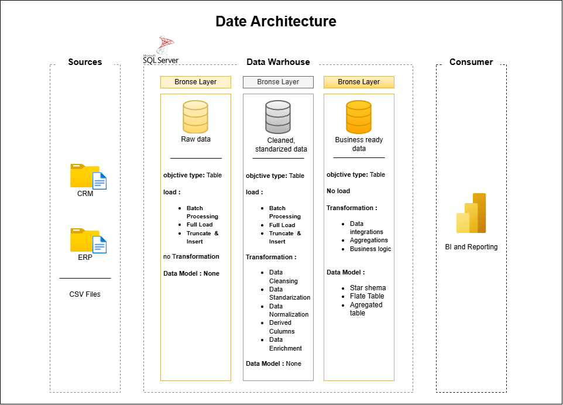
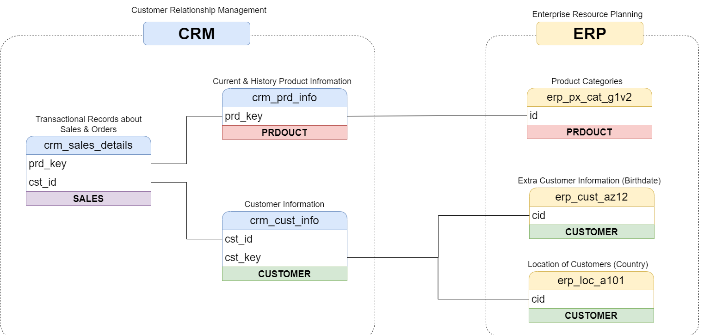

# SQL Data Warehouse & Analytics Engine (Medallion Architecture)
 
[](#2-project-requirements)
[-blue.svg)](#3-data-architecture--pipeline)
[](#4-data-modeling--schema)
[](#5-key-sql-logic)
[](docs/data_catalog.md)
[](#8-author--contact)
 
An end-to-end Data Warehouse and Business Intelligence solution built on Microsoft SQL Server, engineered to ingest raw ERP and CRM data, enforce data quality, model it into an analytical Star Schema, and serve business-ready reporting views.
 
---
 
## Explore the Project
 
Jump straight to the key technical references:
 
* **Architecture Diagrams:** [Data Architecture](docs/data_architecture.drawio.png) · [Star Schema](docs/data%20model.drawio.png) · [Integration Workflow](docs/data_integration.png)
* **Data Dictionary:** [`docs/data_catalog.md`](docs/data_catalog.md)
* **Naming Standards:** [`docs/naming_conventions.md`](docs/naming_conventions.md)
* **Layer Reference Guide:** [`docs/data_layers.pdf`](docs/data_layers.pdf)
---
 
## Table of Contents
1. [About This Project](#1-about-this-project)
2. [Project Requirements](#2-project-requirements)
3. [Data Architecture & Pipeline](#3-data-architecture--pipeline)
4. [Data Modeling & Schema](#4-data-modeling--schema)
5. [Key SQL Logic](#5-key-sql-logic)
6. [Analytics Capabilities & Business Value](#6-analytics-capabilities--business-value)
7. [Repository Structure](#7-repository-structure)
8. [Author & Contact](#8-author--contact)
---
 
## 1. About This Project
 
Organizations often store operational data across disconnected CRM and ERP systems, with inconsistent formats, duplicate records, and no shared definitions of customers, products, or revenue. Without a trusted analytical layer, reporting becomes slow, manual, and prone to conflicting numbers.
 
This project delivers a centralized data foundation designed to solve that problem. Built with **Microsoft SQL Server** and modeled on the **Medallion Architecture** (Bronze → Silver → Gold), it transforms raw source files into a clean, governed Star Schema and exposes analytics and reporting views that surface the "why" behind sales performance across time, products, and customers.
 
### Core Deliverables
* **Automated ETL Pipeline:** Stored-procedure-based bulk ingestion and transformation across Bronze and Silver layers.
* **Analytical Star Schema:** Conformed dimensions and a sales fact table with surrogate keys, ready for BI consumption.
* **Analytics Suite:** Eleven SQL scripts covering exploratory data analysis and advanced analytics.
* **Business Reporting Views:** Consolidated `gold.report_customers` and `gold.report_products` views for direct dashboard connectivity.
---
 
## 2. Project Requirements
 
The warehouse was built against clear technical and environmental requirements to ensure it is reproducible and maintainable.
 
* **Data Catalog:** [docs/data_catalog.md](docs/data_catalog.md)
* **Naming Conventions:** [docs/naming_conventions.md](docs/naming_conventions.md)
### Database & Environment
* **Database Engine:** Microsoft SQL Server 2019+ or Azure SQL Database
* **Supported Client Tools:** SQL Server Management Studio (SSMS) v19+, Azure Data Studio, Visual Studio Code (`mssql` extension)
* **Execution Permissions:** Bulk file ingestion rights (`ADMINISTER BULK OPERATIONS` / `BULK INSERT`) to load the source datasets
### Key Requirements Satisfied
* **Automated Data Processing:** Repeatable, procedure-driven loads (`bronze.proc_load_bronze`, `silver.proc_load_silver`) that refresh each layer on demand.
* **Data Quality Enforcement:** Cleansing, deduplication, standardization, and type correction applied before data reaches the presentation layer.
* **Standardized Metric Definitions:** Unified calculations for revenue, units sold, order counts, Average Order Value (AOV), and Average Order Revenue (AOR).
* **Clear Layer Separation:** Each medallion layer has a single responsibility and a dedicated schema.
---
 
## 3. Data Architecture & Pipeline
 
Data flows through three progressively refined layers:
 
```text
[ Source ERP & CRM Datasets ]
            │
            ▼  (Bulk Ingestion / Staging)
🥉 Bronze Layer   bronze.ddl_bronze · bronze.proc_load_bronze
            │
            ▼  (Cleansing, Deduplication, Standardization)
🥈 Silver Layer   silver.ddl_silver · silver.proc_load_silver
            │
            ▼  (Star Schema Modeling, Surrogate Keys, Dimension Conforming)
🥇 Gold Layer     gold.dim_customers · gold.dim_products · gold.fact_sales
            │
            ├──► 📊 Reporting Views    gold.report_products · gold.report_customers
            └──► 📈 Advanced Analytics YoY Performance · Segmentation · Moving Averages
```
 
### Layer Responsibilities
 
| Layer | Schema | Purpose | Transformations |
|-------|--------|---------|-----------------|
| 🥉 **Bronze** | `bronze` | Raw staging, unmodified ingestion from source files | None (as-is load) |
| 🥈 **Silver** | `silver` | Cleansed, standardized, deduplicated, typed entities | Cleansing, deduplication, standardization |
| 🥇 **Gold** | `gold` | Business-ready Star Schema and reporting views | Surrogate keys, dimension conforming, aggregation |
 
### Architectural Diagrams
 
**Data Architecture Pipeline**
 

 
**Source-to-Target Data Integration Workflow**
 

 
*Full layer documentation is available at [`docs/data_layers.pdf`](docs/data_layers.pdf).*
 
---
 
## 4. Data Modeling & Schema
 
The Gold layer is structured as a **Star Schema** to ensure fast analytical queries, consistent business definitions, and unambiguous joins:
 
```text
+-------------------+      +-------------------+
|   dim_customers   |      |   dim_products    |
+-------------------+      +-------------------+
          | 1                        | 1
          |                          |
          | *                        | *
          +----------+     +---------+
                     |     |
               +-------------------+
               |    fact_sales     |
               +-------------------+
```
 
* **`gold.fact_sales` (Fact Table):** Captures atomic sales transactions, including order identifiers, order dates, sales amounts, quantities, and surrogate keys linking to each dimension.
* **`gold.dim_customers`:** Conformed customer dimension combining CRM and ERP attributes such as demographics, geography, and birthdate.
* **`gold.dim_products`:** Conformed product dimension covering categories, subcategories, product lines, and cost.
**Dimensional Star Schema Model**
 

 
*Column-level definitions are documented in the [Data Catalog](docs/data_catalog.md).*
 
---
 
## 5. Key SQL Logic
 
The analytics layer is organized by analytical domain (Exploration, Time-Series, Performance, Segmentation, and Reporting). The snippets below are representative of the techniques used; refer to the scripts in [`data analytics/`](#7-repository-structure) for the full implementations.
 
### 1. Ranking & Magnitude
```sql
-- Top 5 products by revenue
SELECT *
FROM (
    SELECT
        p.product_name,
        SUM(f.sales_amount) AS total_revenue,
        RANK() OVER (ORDER BY SUM(f.sales_amount) DESC) AS rank_products
    FROM gold.fact_sales f
    LEFT JOIN gold.dim_products p
        ON p.product_key = f.product_key
    GROUP BY p.product_name
) t
WHERE rank_products <= 5;
```
 
### 2. Time-Series & Cumulative Analysis
```sql
-- Monthly sales with running total and moving average price
SELECT
    order_date,
    total_sales,
    SUM(total_sales)  OVER (ORDER BY order_date) AS running_total_sales,
    AVG(avg_price)    OVER (ORDER BY order_date) AS moving_average_price
FROM (
    SELECT
        DATETRUNC(MONTH, order_date) AS order_date,
        SUM(sales_amount)            AS total_sales,
        AVG(price)                   AS avg_price
    FROM gold.fact_sales
    WHERE order_date IS NOT NULL
    GROUP BY DATETRUNC(MONTH, order_date)
) t;
```
 
### 3. Year-over-Year Performance
```sql
-- Yearly product sales vs. historical average and prior year
WITH yearly_product_sales AS (
    SELECT
        YEAR(f.order_date) AS order_year,
        p.product_name,
        SUM(f.sales_amount) AS current_sales
    FROM gold.fact_sales f
    LEFT JOIN gold.dim_products p
        ON f.product_key = p.product_key
    WHERE f.order_date IS NOT NULL
    GROUP BY YEAR(f.order_date), p.product_name
)
SELECT
    order_year,
    product_name,
    current_sales,
    AVG(current_sales) OVER (PARTITION BY product_name) AS avg_sales,
    current_sales - LAG(current_sales) OVER (PARTITION BY product_name ORDER BY order_year) AS py_diff
FROM yearly_product_sales;
```
 
### 4. Customer Segmentation
```sql
-- Loyalty tiers based on tenure and lifetime spend
CASE
    WHEN lifespan >= 12 AND total_spending > 5000 THEN 'VIP'
    WHEN lifespan >= 12 AND total_spending <= 5000 THEN 'Regular'
    ELSE 'New'
END AS customer_segment
```
 
### 5. Part-to-Whole Contribution
```sql
-- Category share of total enterprise sales
SELECT
    category,
    SUM(sales_amount) AS category_sales,
    CONCAT(
        ROUND(CAST(SUM(sales_amount) AS FLOAT) / SUM(SUM(sales_amount)) OVER () * 100, 2),
        '%'
    ) AS percentage_of_total
FROM gold.fact_sales f
LEFT JOIN gold.dim_products p
    ON p.product_key = f.product_key
GROUP BY category;
```
 
---
 
## 6. Analytics Capabilities & Business Value
 
The analytics suite turns the Gold layer into answers to concrete business questions. Each module maps to a decision area.
 
### 1. Exploratory Data Analysis (EDA)
* **Metadata & Dimensions:** Validates schema definitions with `INFORMATION_SCHEMA` and audits unique categories and geographic territories.
* **Time Horizons & Demographics:** Detects temporal boundaries (`MIN`/`MAX` dates) and demographic ranges (youngest vs. oldest customers).
* **Measures & Magnitude:** Aggregates gross revenue, units sold, distinct orders, and registered vs. purchasing customer accounts.
* **Ranking:** Surfaces top and bottom performing products and high-value customers using `RANK() OVER (...)` and `TOP`.
### 2. Advanced Analytics Suite
* **Time-Series Analysis:** Tracks revenue trends and seasonality with `DATETRUNC()`, `DATEPART()`, and `FORMAT()`.
* **Cumulative Computations:** Calculates running sales totals and moving price averages using `SUM() OVER (ORDER BY ...)`.
* **Performance Benchmarking:** Analyzes Year-over-Year (YoY) revenue changes with `LAG()` and benchmarks yearly sales against product historical baselines.
* **Entity Segmentation:** Classifies products into cost bands and customers into `VIP`, `Regular`, and `New` loyalty tiers.
* **Part-to-Whole Share:** Measures category revenue as a percentage of total sales using `SUM() OVER ()`.
### 3. Business Reporting Views (`gold.report_*`)
* **`gold.report_products`:** Consolidates orders, units sold, total revenue, product lifespan, recency in months, performance tiering (`High-Performer`, `Mid-Range`, `Low-Performer`), Average Order Revenue (AOR), and average monthly revenue.
* **`gold.report_customers`:** Consolidates customer lifespan, demographic age brackets, loyalty tiers (`VIP`, `Regular`, `New`), purchase recency, Average Order Value (AOV), and average monthly spend.
### Strategic Questions This Warehouse Helps Answer
 
| Business Question | Supporting Analysis |
|-------------------|---------------------|
| Which products and categories drive revenue, and which lag? | Ranking, Part-to-Whole, `report_products` |
| Is performance growing, seasonal, or declining? | Change Over Time, Cumulative, YoY Performance |
| Who are our most valuable customers, and who is at risk of lapsing? | Segmentation, Recency, `report_customers` |
| Where is demand concentrated geographically and demographically? | Dimensions Exploration, age brackets |
| Which products are underperforming against their own history? | Performance Analysis (`LAG`, historical average) |
 
---
 
## 7. Repository Structure
 
```plaintext
├── datasets/                                 # Dataset definition scripts
│   └── ddl_gold.sql                         # Gold star schema definitions
├── docs/                                     # Diagrams, specs & data catalogs
│   ├── data model.drawio.png                # Star schema ERD
│   ├── data_architecture.drawio.png         # Medallion data architecture
│   ├── data_catalog.md                      # Data catalog & column definitions
│   ├── data_integration.png                 # Source-to-target integration workflow
│   ├── data_layers.pdf                      # Data layers reference guide
│   └── naming_conventions.md                # Object & column naming standards
├── scripts/                                  # Database ETL & DDL scripts
│   ├── init_database.sql                    # Database & schema creation
│   ├── bronze/
│   │   ├── ddl_bronze.sql                   # Bronze layer DDL
│   │   └── proc_load_bronze.sql             # Bronze bulk load stored procedure
│   ├── silver/
│   │   ├── ddl_silver.sql                   # Silver layer DDL
│   │   └── proc_load_silver.sql             # Silver ETL transformation procedure
│   └── gold/
│       └── ddl_gold.sql                     # Gold dimensional DDL views
├── data analytics/                           # Analytics & BI SQL scripts
│   ├── Exploratory data analysis/
│   │   ├── 01_database_exploration.sql      # Schema metadata inspection
│   │   ├── 02_dimensions_exploration.sql    # Categorical & geographic profiling
│   │   ├── 03_date_range_exploration.sql    # Temporal boundaries & age ranges
│   │   ├── 04_measures_exploration.sql      # Top-line measures & executive KPI sheet
│   │   ├── 05_magnitude_analysis.sql        # Revenue & customer magnitude breakdowns
│   │   └── 06_ranking_analysis.sql          # Top/bottom rankings (TOP, RANK)
│   ├── Advance analytics/
│   │   ├── 07_change_over_time_analysis.sql # Time-series & date grouping
│   │   ├── 08_cumulative_analysis.sql       # Running totals & moving averages
│   │   ├── 09_performance_analysis.sql      # YoY shifts & historical variance
│   │   ├── 10_data_segmentation.sql         # Cost tiers & customer VIP/Regular segments
│   │   └── 11_part_to_whole_analysis.sql    # Proportional sales contribution (% of total)
│   └── Reporting/
│       ├── Report_customers.sql             # Customer behavioral reporting view
│       └── Report_products.sql              # Product performance reporting view
└── README.md                                 # Main repository overview and documentation
```
 
### Execution Order
1. `scripts/init_database.sql` — create the database and the `bronze`, `silver`, and `gold` schemas
2. `scripts/bronze/ddl_bronze.sql` → `proc_load_bronze.sql` — create and load raw tables
3. `scripts/silver/ddl_silver.sql` → `proc_load_silver.sql` — cleanse and standardize
4. `scripts/gold/ddl_gold.sql` — build the Star Schema views
5. `data analytics/` — run the EDA, advanced analytics, and reporting scripts
---
 
## 8. Author & Contact
 
**Mustapha Outgougua**
 
Data Analyst | SQL Developer | Business Intelligence Specialist
 
- 💼 [LinkedIn](https://www.linkedin.com/in/mustapha-outgougua)
- 🐙 [GitHub](https://github.com/outgouguamustapha)
- 📧 Open to collaboration and opportunities
---
 
<div align="center">
**If you found this project insightful, please consider giving it a ⭐!**
 
Made with ❤️ and SQL Server
 
</div>
